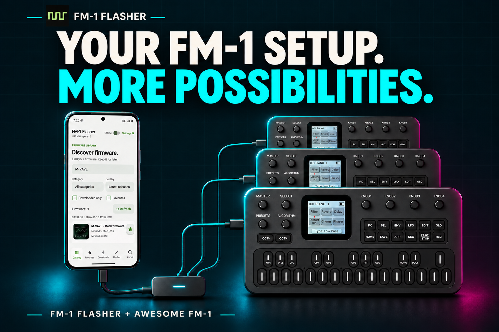
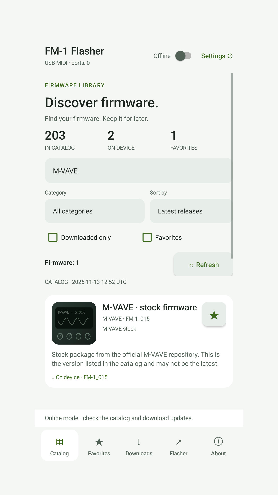

# FM-1 Flasher

Browse, save and install firmware for your **M-VAVE FM-1** from an Android phone. Keep a local firmware library and update one instrument or several in sequence over USB OTG.

**Version 0.10.1** — experimental flash inspection, bootloader management and backup restoration. [Available APKs](https://github.com/ekim-pl/android-fm1-flasher/releases) · [Build and verification](publication/qa/0.10.1.txt).

Version 0.10.1 enables experimental bootloader installation, ROM firmware installation and same-device backup restoration, with a reviewed plan and exported backup required before writing.

## Project manifesto

FM-1 Flasher is an independent initiative and will always remain independent, open source, transparent and free of charge. Its source code and development decisions will remain open to public review, and the application will remain free to use.

## Your firmware, available offline

- **Local firmware files:** download packages to your phone for later installation. Downloading never starts flashing.
- **Local library database:** saved catalog information, favorites and download records remain available between sessions. Previously downloaded packages can be installed without internet access.
- **Offline mode:** pause catalog checks and downloads while continuing to use your saved library. New releases and newly withdrawn firmware cannot be discovered offline.
- **Several FM-1s, one queue:** connect through an OTG hub, name each instrument and assign its own firmware. Installation runs **one instrument at a time**, with individual results. Multiple-device updates require manual pairing after restarts; automatic matching is disabled pending hardware tests.
- **Instrument colors:** choose one of six accents in device Details, including for disconnected saved instruments. Colors persist across restarts and manual pairing, and identify devices in lists, tasks and progress bars.
- **Your interface:** English, Polish and Simplified Chinese, with light, dark or system appearance.

## Getting started

1. Install an APK on **Android 14 or newer**, with USB Host/OTG support. Use a data cable; for several instruments, a powered hub is recommended.
2. In **Library**, choose firmware and download it.
3. Connect your FM-1, open **Devices** and read the instrument. Confirm its memory type and choose a compatible downloaded package.
4. Add it to **Tasks**, review the plan and start installation. Repeat for additional instruments before starting the queue.

Keep power and USB connections stable throughout installation. A normal firmware update does not create a device backup and may change instrument settings.

## Firmware sources — third-party, untrusted content

- **[The Firmware Hub](https://thefirmwarehub.com):** the built-in catalog, enabled by default.
- **[Awesome FM-1](https://github.com/ekim-pl/awesome-fm1):** a community directory of firmware projects, available as an optional source.
- **Your own sources:** add supported HTTPS catalogs, GitHub repositories with firmware releases or direct `.fwsc` links in **Settings → Firmware sources**. Private sources can use authentication.

Treat every source and firmware package as **untrusted third-party content**, including built-in catalogs. Inclusion is not an endorsement or a guarantee of safety. File-integrity checks do not prove an author's identity or firmware quality; check the publisher and hardware compatibility before installing. Unsafe or incompatible firmware can erase data or leave the instrument unable to boot. Read the [third-party firmware risk notice](docs/firmware-safety.md). Firmware retains its authors' licenses; The Firmware Hub catalog is credited under CC BY 4.0.

## Backups and experimental tools

Extra tools are **hidden by default**. Enable **Settings → Experimental features** to access full-flash backup/export, flash-chip detection, MIDI logging, operation-log export and limited ROM recovery.

The experimental backup tool reads the **entire 1 MiB flash memory** of supported chips in USB ROM/download mode, compares two complete reads and stores the copy locally. You can export it as a ZIP archive. This is separate from downloading a firmware package.

**Flash inspection and recovery** can install the bundled m-bootloader 2.4, restore the stock V15 bootloader, install compatible downloaded firmware over ROM, and restore a verified backup to the same device with or without its bootloader. Prepare a plan, export its new pre-write backup, then choose **Write reviewed plan** and confirm. Supported chips are Puya `0x856014` and UCUN `0xB36014`; factory key/MAC data are always preserved. The separate limited V15 application recovery remains available. Write verification does not establish a successful boot; the newly enabled operations still need physical acceptance testing.

## Acknowledgements

Thank you to **Julius Vitkauskas** for [M-Flasher](https://github.com/jvitkauskas/m-flasher) and [m-bootloader](https://github.com/jvitkauskas/m-bootloader). Their open-source code, protocol documentation and loaders made these flash diagnostics, bootloader and recovery tools possible. Adapted code and bundled binaries retain their MIT attribution; see the [component notice](third_party/m-flasher-NOTICE.md) and [license](third_party/m-flasher-LICENSE.txt).

## Privacy and more information

No app account or advertising. The library, device names and task history stay on your phone. Firebase-enabled builds collect usage statistics by default; turn them off in **Settings → Usage statistics**. External firmware services receive connection metadata. [Privacy policy](PRIVACY_POLICY.md).

[Detailed user guide](docs/user-guide.md) · [Project website](https://ekim-pl.github.io/android-fm1-flasher/) · [Polski](website/pl/documentation.md) · [简体中文](website/zh-CN/documentation.md) · [Development and tests](MIGRATION.md) · [Dependency licenses](third_party/README.md)

Questions, feedback or beta testing: [ekim.pl@gmail.com](mailto:ekim.pl@gmail.com).

## Distribution builds

- **Developer/debug:** `android-debug.yml` builds a signed APK with test Firebase and the persistent developer key.
- **F-Droid:** Add the [project repository](https://ekim-pl.github.io/android-fm1-flasher/fdroid/repo/) to an F-Droid client for releases. `fdroid-release.yml` builds the signed APK without Firebase or Google Play services; `fdroid.yml` separately validates an unsigned APK. Providing the signed APK does not mean inclusion in the official F-Droid catalog.
- **Google Play:** `google-play.yml` builds a signed AAB with production Firebase. `google-play-upload.yml` uploads the verified bundle to internal testing; `promote-production.yml` promotes that same version.

`android-release.yml` builds all three distributions from one immutable stable tag and publishes the debug/F-Droid APKs, manifests and checksums on GitHub. The Play bundle is retained as an Actions artifact; upload and promotion remain separate steps. All distributions use the same application ID, so switching requires compatible signing certificates. [Build and publication instructions](publication/github-actions.txt).

## Screenshots

Screenshots are included in the [user guide](docs/user-guide.md#screenshots). Captured from version 0.10.0 on Android 16.

Source refresh defaults are set at build time: release builds use 8 hours and debug builds use 1 hour. Override them with `-Pfm1RefreshHours=<hours>` and `-Pfm1DebugRefreshHours=<hours>` (1–168). Existing source intervals are preserved. In experimental mode, an explicit manual refresh can check a source again before its interval; server retry delays still apply. The Firmware Hub catalog retains its required 24-hour minimum in every mode.
