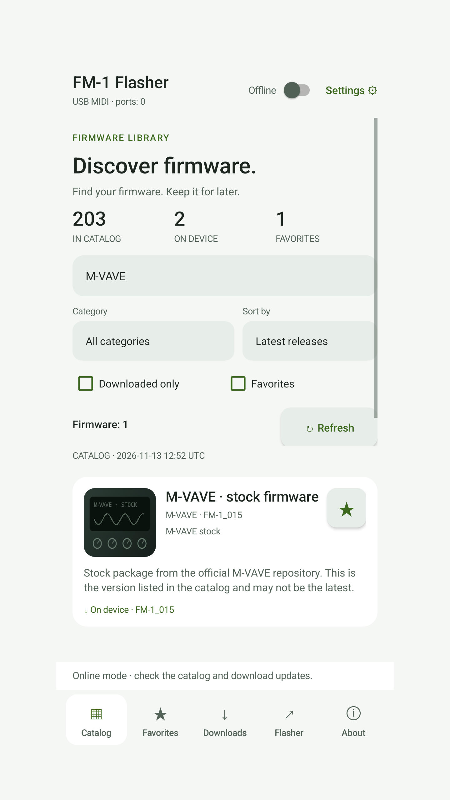
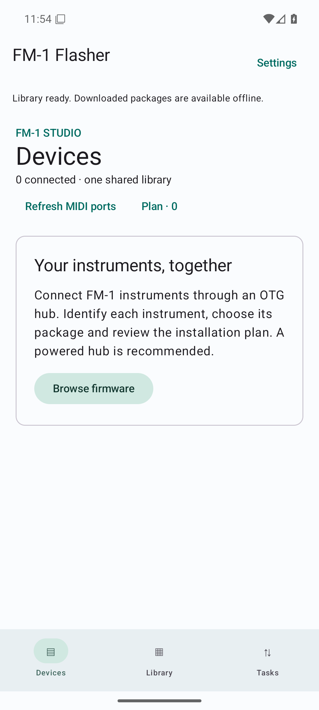
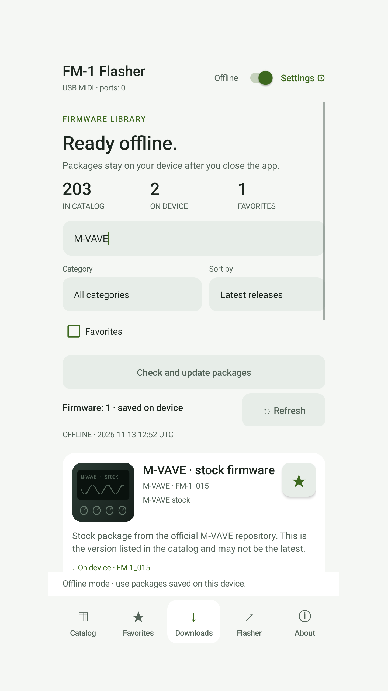

# FM-1 Flasher user guide

Detailed instructions for the Android application: local firmware, offline use, firmware sources, sequential updates and experimental tools. Commands in this guide run from the repository root.

FM-1 Flasher **0.10.1** includes a local firmware library, source colors, full-screen settings and sequential installation tasks. Experimental tools add flash diagnostics, backup import, bootloader management, ROM firmware installation and same-device backup restoration.

[Project README](../README.md) · [Polski](../website/pl/documentation.md) · [简体中文](../website/zh-CN/documentation.md) · [Privacy](../PRIVACY_POLICY.md)

**Contents:** [Getting started](#getting-started) · [Local files and offline use](#local-files-and-offline-use) · [Firmware sources](#library-and-sources) · [Several instruments](#multiple-fm1-devices-on-a-hub) · [Full-flash backups](#full-flash-backups) · [Experimental tools](#settings-and-experimental-tools) · [Build and tests](#building-and-testing)

## Platform support

Android 14+, USB Host/OTG and MIDI are required.

The Android application ID is `pl.ekim.fm1_flasher`. English, Polish and Simplified Chinese interfaces and light/dark/system themes are available.

## Getting started

[](https://ekim-pl.github.io/android-fm1-flasher/fdroid/repo/)

Add the [project repository](https://ekim-pl.github.io/android-fm1-flasher/fdroid/repo/) to an F-Droid client to install and update the app, or download an APK from [GitHub releases](https://github.com/ekim-pl/android-fm1-flasher/releases). The project repository is separate from the official F-Droid catalog. Switching distributions requires compatible signing certificates.

1. Install the 0.10.1 APK on Android 14 or newer. Updating requires the same signing certificate; a Google Play build may use a different certificate from local test builds.
2. Open **Library**, find firmware and download it from its detail screen. Downloading verifies the package; it does not start an installation.
3. Connect instruments with data-capable cables and an OTG hub. A separately powered hub is recommended. The app cannot measure or certify hub power quality.
4. In **Devices**, use **Read instrument** on each card and grant Android USB access when requested. Only a recognized FM-1 can be added to the plan.
5. Open **Details** to set a useful instrument name. Choose the memory type from known hardware information and a local package for that instrument. A package compatible with both supported memory types can be allowed even when memory type is unknown; explicitly incompatible packages remain blocked; unknown compatibility requires the separate force confirmation described below.
6. Choose **Add to plan** for each instrument. Each device can have one pending/running job. Package assignments may differ between devices.
7. Open **Tasks**, review names, versions and hashes, then choose **Install on N instruments**. This is the plan approval; there is no second ordinary confirmation dialog.

Preserve power and USB connections until verification finishes. Use firmware-specific tools to back up instrument data when available; an OTA update is not an automatic backup. Firmware can change instrument settings.

## Local files and offline use

Downloaded firmware packages are stored as local `.fwsc` files in the application's private storage. The local library database keeps catalog entries, source settings, favorites and download records. Device names and task history are also stored locally. These records survive app restarts; they do not require an app account or cloud storage.

Download a package in **Library** before going offline. Merely viewing a catalog entry or checking a source does not make its firmware available offline. Saved packages are checked again when loaded for installation.

Enable **Settings → Offline mode** to stop catalog, artwork and firmware-download requests and pause background checking. You can browse cached catalog information, use favorites and install already downloaded packages. Offline mode cannot discover new releases or newly withdrawn packages. Previously known withdrawal and conflict information still applies.

Local files remain available while kept in app storage. Clearing downloaded firmware removes the package files; clearing app data or uninstalling removes locally stored app data. Export recovery backups separately if you need to retain them outside the app.

## Library and sources

**Library** combines search, favorites and local downloads. **Only downloaded** and **Favorites** are filters, not separate Android navigation tabs. **Filters & sort** expands category, sort and source controls. When the downloaded filter is active, the package-update action is available.

Package details show versions, source/author links, compatibility and SHA-256. Selecting a saved package returns to Devices; it does not write firmware. Ordinary removal has **Undo** during the current app session for a valid package. A package referenced by a queued or running job cannot be deleted or replaced: remove its pending task first. Favorites survive package removal.

Treat all firmware sources, including built-in catalogs, as **untrusted third-party content**. Inclusion is not an endorsement or a guarantee of safety. Hash checks verify file integrity, not publisher identity or firmware quality. Unsafe or incompatible firmware can cause data loss or leave the instrument unable to boot. Check the author and hardware compatibility before installing, and read the [third-party firmware risk notice](firmware-safety.md).

Open **Settings → Firmware sources**:

- **[The Firmware Hub](https://thefirmwarehub.com)** starts enabled; **Awesome FM-1** starts disabled. [Awesome FM-1](https://github.com/ekim-pl/awesome-fm1) is a community directory linking to firmware projects and their publishers.
- A custom source can use a supported HTTPS catalog, GitHub releases repository or direct FWSC URL, with a name, a 1–168 hour interval and the applicable package/artwork URL scopes. **Save** records the configuration; **Check now** is a separate action. Newly configured sources start disabled.
- Scheduled refreshes follow the source interval, including after failed attempts. Release builds default to 8 hours and debug builds to 1 hour; each source keeps its configured interval. Manual checks in experimental mode can bypass the interval for sources other than The Firmware Hub, while server retry delays still apply. The Firmware Hub always keeps a 24-hour minimum. The source screen shows errors and the next allowed check.
- Disabled sources make no automatic requests. An explicit Check now may check a disabled source. A failed source retains its cached snapshot; other sources can still update.
- Removing a custom subscription preserves packages, favorites, provenance and known withdrawals. Restoring defaults enables Hub and disables Awesome FM-1 without removing custom subscriptions.
- Optional background catalog checking starts off. It checks enabled catalogs when network conditions allow; some providers fetch firmware bytes for identification, but saving offline packages and installing firmware require explicit actions.

Offline mode suppresses catalog, package and artwork network requests and pauses background checking. Saved packages can be flashed without a network request. Offline use cannot discover a withdrawal that has not yet reached the local catalog. Catalog declarations and hashes do not by themselves establish publisher authenticity.

In **Settings → Firmware sources → Source color**, choose one of eight colors or Automatic for each source. The dot beside the source name marks its firmware in the library, downloaded packages and package details. Colors are stored on this device and can be changed offline.

## Catalog providers and authentication

Android has adapters behind the shared `CatalogProvider` interface:

| Provider | Behavior |
| --- | --- |
| `thefirmwarehub` | Built-in Firmware Hub JSON catalog and its existing package policy |
| `awesome-fm1` | Built-in Awesome FM-1 JSON catalog and approved URL scopes |
| `repo-url` | GitHub.com repository URL, published releases/prereleases and `.fwsc` assets; drafts are excluded |
| `pkg-url` | A direct HTTPS `.fwsc` URL, identified and hashed from the actual package |

The `catalog-json` adapter preserves existing custom JSON subscriptions. Adding providers does not discard old source IDs, favorites, local packages or history. Save a manual source, use **Check now**, and enable it to make its offers available. Checks are bounded; a failed/incomplete import preserves the previous snapshot. GitHub pagination and asset responses respect retry delays. Large repositories may need authentication to fit GitHub rate limits.

For repository assets, GitHub SHA-256 digests are used when available; the app reads a package prefix for its product identity. Older assets without a digest require fetching and validating the package to compute its hash. A direct package check also fetches and validates the package. These checks may transfer binary bytes without marking a package as downloaded for offline use. **Download** remains the action that stores it in the firmware library; no installation is automatic.

Manual providers do not infer supported flash chips from filenames. After checking a source, open **Edit → Package compatibility**, confirm the publisher information for each SHA-256, return and save. The declaration updates metadata for matching bytes, including a matching local copy; it does not apply to another binary at the same URL or another release. Unknown compatibility blocks normal installation; forcing requires a separate warning and risk confirmation. An unknown declaration does not contradict known metadata; contradictory explicit identities/chip declarations still block use.

The source form offers None, HTTP Basic, Bearer, API key in a chosen safe header, and OAuth 2.0. Basic takes username/password; Bearer takes the token without the `Bearer` prefix. API key sends the entered header value literally (including an explicit prefix if using `Authorization`). Passwords, tokens and client secrets are encrypted with Android Keystore, separate from SQLite source metadata, and are not logged. Empty secret fields keep a saved secret only for unchanged source/provider/authentication identity; a different URL cannot inherit it. Source deletion and restoring built-in defaults remove the relevant saved secrets.

Register the redirect below with your provider before authorizing. When upgrading an older installation, verify its registered redirect and restart any pending sign-in.

OAuth supports browser Authorization Code with **PKCE S256** and service **Client Credentials**. Configure your issuer, client ID, scope, token endpoint and, for browser sign-in, authorization endpoint. Register `pl.ekim.fm1-flasher://oauth/callback` with the issuer. Client Credentials needs a client secret; a public PKCE client does not. Select `client_secret_basic` or `client_secret_post` as required by the issuer. Save, then choose **Authorize OAuth 2.0** on the source card. Tokens are refreshed when expired if the server supplies a refresh token; Client Credentials can obtain another token. Browser state is one-use, source/revision-bound and expires after ten minutes. No universal OAuth client ID or secret is bundled.

Authenticated requests are limited to the configured source origin (GitHub API origin for `repo-url`). Authorization is stripped on cross-origin redirects, including CDNs; token POST redirects are refused. HTTPS and existing public-address/URL-scope restrictions remain. Source intervals can be set from 1 to 168 hours. Release builds default to 8 hours and debug builds to 1 hour. In experimental mode, a manual check can bypass the interval for non-Hub sources; server retry delays still apply and The Firmware Hub keeps a 24-hour minimum. Explicitly replacing credentials or completing authorization permits a new check so a previous authentication failure does not force a wait for the configured interval.

## Multiple FM1 devices on a hub

A device card has a local record, name/color, observed firmware identity, memory selection and current attachment. **USB addresses are not physical hub socket numbers.** Model/version, VID/PID and JEDEC chip type do not uniquely identify an instrument. Observed USB serials are retained locally but have not been validated as unique across FM-1 operating modes.

Only one job changes modes at a time. After a planned restart, Android tracks USB/MIDI events, excludes unchanged neighbors and requires a single eligible return. All other observed attachments must remain continuous. With several instruments, use the **inline pairing action in Tasks** only for the instrument being updated. There is no override to guess among multiple candidates. Do not swap indistinguishable devices during a transition.

Automatic multi-device pairing remains disabled pending physical tests. The older conservative automatic path is available only when there are no MIDI siblings and Android reports one eligible MIDI endpoint and one USB device. An observed serial never independently authorizes automatic matching. System USB permission may be required again after disconnect/re-enumeration.

A lost neighbor, hub reset, changed attachment generation, contradictory serial or ambiguous port arrangement stops further writing. Multiple MIDI port pairs or multiple MIDI endpoints on one USB device are blocked. A confirmed result means the return and expected firmware model/version were checked; it is not a complete flash-memory readback.

Saved names survive restart, but live bindings do not survive process death or an untrusted disconnect. Read and physically identify the instrument again, remove affected pending jobs, then use **Saved instruments → Assign this saved name**. Pairing resets the old memory-type selection; choose it again before rebuilding the plan.

## Instrument colors

In **Devices → Details → Instrument color**, choose one of six named colors. The selection saves immediately; you can also change a disconnected saved instrument. Names and a selection mark make the picker usable without relying on color alone.

The accent appears beside the instrument name in connected/saved device lists, queued tasks and history, and on its flashing progress bar. Error and warning colors retain their usual meaning. Color editing is disabled while the app is busy or the device has a queued/running task.

Choosing a color remembers the device even if its name is still the default. It survives app restarts and explicit pairing with the returning instrument. Colors are visual labels, not hardware identities; they do not enable automatic matching. Each task keeps the color from when it was queued, so changing a device later does not recolor its history.

### Try colors without hardware

Debug builds include a separate **FM1 Color Demo** launcher icon. Open device Details to select colors; **Jasny / ciemny** switches the theme, and **Pokaż / wyczyść zadania** shows or clears sample tasks, including fixed 47% progress. Clear sample tasks before editing colors again. Demo colors survive a restart in separate local preferences. The demo never connects to USB or changes the real fleet; it is absent from release builds.

## Tasks, stopping and failures

Jobs freeze the target record/attachment, expected identity, memory selection, package key and hash. All plan packages are checked before the first write; each job is checked again before its transfer. Changing the UI's selected package cannot redirect an active job.

- **Stop after this instrument** finishes the current write and return verification. Remaining jobs stay queued. There is no button that abruptly cancels a live firmware write.
- A failed job stops the run. Inspect the instrument and the task's details before a new attempt; the app does not silently move its package to another device.
- Progress and results remain in Tasks. Details show the full package hash and recorded stage times. Persistent stage history is bounded to 64 entries per job.
- After process interruption, an active job becomes **unconfirmed**. No transfer resumes automatically from a saved percentage. Pending jobs remain visible but their old live bindings must be rebuilt.
- If the plan no longer matches current connections/packages, remove affected tasks, read the instruments and add fresh tasks. A rejected USB request does not authorize writing.

The Android foreground service and time-limited wake lock support an active transfer while the screen is off or another app is foregrounded. They cannot guarantee USB power or prevent every system/process interruption. Return to the app when an inline pairing or system grant is needed.

## Full-flash backups

A downloaded firmware package is an installation file. A recovery backup is a copy read from the instrument's flash memory. Normal MIDI firmware installation does not automatically create this backup.

To access the backup tools, enable **Settings → Experimental features**, open the device tools and connect a supported instrument in **USB ROM/download mode**. This is separate from the normal MIDI update workflow. The backup operation accepts only recognized flash chips and the supported device key.

The tool reads the entire **1 MiB flash memory twice** and saves a backup only if both reads match. It stores the image (`full-flash-before.bin`), a checksum and device metadata locally. Use the backup export action to save a ZIP archive through Android's file picker; the archive includes the full image, metadata and any recorded recovery result.

**Import backup** accepts app ZIP exports or a 1 MiB BIN with its JSON sidecar. A verified backup can be restored to the same device when UID, chip identity and factory data match. Missing identity or integrity metadata permits inspection only. See [experimental flash writing](#experimental-flash-inspection-and-writing) for the preparation, export and confirmation steps. The separate stock V15 recovery action retains its limited application-only range.

The backup and recovery logic has unit tests with simulated flash memory. Physical recovery remains unverified; a saved backup does not guarantee that the app can restore an instrument to its previous state.

## Settings and experimental tools

Settings contains language/theme, offline mode, sources, About and privacy. **Experimental features** is off by default. Enabling it exposes MIDI Logger and the recovery tools; it cannot be changed during a busy operation. Regular Android installation uses Devices and Tasks.

The receive-only MIDI logger has bounded buffers and selected inputs. It stops automatically when connecting/flashing; simultaneous logging and flashing are not promised.

JEDEC detection uses a separate USB ROM/download-mode device. Its result is never automatically assigned to a MIDI instrument. The experimental flash tools support bootloader, firmware and same-device backup writes with a prepared plan, exported backup and explicit confirmation. They never start automatically after a failed MIDI update. The older limited V15 application recovery remains a separate action.

## Full-screen settings

**Settings** is a full screen with Interface, Firmware library, Experimental features and Application cards. Language and theme use inline radio choices. Sources, source editing, per-package compatibility and privacy open as full pages. The header and system Back return one level; the original Library/Devices/Tasks tab and non-secret source drafts survive activity recreation. Password/token inputs are intentionally not saved in activity state. Destructive confirmations and the requested chip-result popup remain dialogs.

## Diagnostics and storage cleanup

The app always records a bounded local operation log (daily files, seven days by default; up to 256 KiB per day and 10 MiB total). It survives app restarts and includes timestamps, actions, USB/MIDI port changes, firmware-transfer stages and caught errors. Raw MIDI traffic and firmware bytes are not recorded. Open **Settings → Experimental features** to access **Export operation log** (JSON Lines, `.jsonl`) and **Clear operation log**. Export uses the system file picker; no log is uploaded automatically. Clearing requires one confirmation and does not delete copies you already exported. New events continue to be logged. The separate MIDI Logger remains a live raw-MIDI diagnostic tool.

In **Settings → Clear downloaded firmware**, confirm once to delete all downloaded package files and metadata, including damaged/orphan files. The selected package and single-package Undo are cleared. Favorites, catalog sources, device names, task history and recovery backups remain. Remove queued tasks first; cleanup is blocked during work and while any queued/running job owns a package. Offline installation requires downloading packages again.

**Devices → Modes and flash chip** provides MIDI selection/readout, download-mode entry and chip detection in separate cards. Successful chip detection opens a result popup. Power-cycle back to MIDI afterwards. Default disconnected device entries are temporary; custom names, manually chosen colors and queued targets are retained. Delayed USB detach events for a retired stage no longer invalidate the next stage of the same update. Unrelated device/hub loss still blocks writes.

## Building and testing

Use JDK 17, Android SDK platform 36 and Build Tools 35.0.0. The project pins Gradle through its wrapper, AGP 8.13.2, Kotlin 2.2.21 and Compose 1.9.3. Configure the SDK through the local environment or Android tooling.

```sh
python3 tools/sync-resources.py --check
./gradlew :shared:jvmTest :app:testDebugUnitTest :app:lintDebug :app:assembleDebug :app:assembleDebugAndroidTest
```

APK: `app/build/outputs/apk/debug/app-debug.apk`. Test APK: `app/build/outputs/apk/androidTest/debug/app-debug-androidTest.apk`. `dist/` is ignored by Git; the prepared build-19 copy is local, not a guaranteed file in a fresh clone.

Android XML under `app/src/main/res/values*` is authoritative for UI translations. Run `python3 tools/sync-resources.py` after changing it. App About documents are `about/app*.md`; Android bundles them with license/third-party documents through `:app:bundleProjectDocs`. The root README is not the in-app About document.

See [implementation and reproducible test commands](../MIGRATION.md), [acceptance checklist](../tests/android14-acceptance.txt) and [website build instructions](../website/pages.md). Publishing is a separate step; [the inherited Google Play workflows do not currently target this fork's application ID](../publication/github-actions.txt).

## Future iOS port

A port to iOS is planned for the future. There is no iOS release or announced release date.

## Privacy and attribution

No application account or advertising; optional Firebase builds provide default-on statistics with a Settings opt-out (see [analytics setup](../docs/ANALYTICS.md)); optional source authentication uses the account or service credentials you configure. The library, names, observed serials, memory selections and task history are local. External catalog/artwork/download servers receive connection metadata; instrument identities are not attached to those requests. See the [privacy policy](../PRIVACY_POLICY.md).

App code: [MIT](../LICENSE.md). Catalog attribution: [The Firmware Hub](https://thefirmwarehub.com), CC BY 4.0; firmware remains under its authors' licenses. [Awesome FM-1](https://github.com/ekim-pl/awesome-fm1) is an optional directory. Dependency licenses and attribution are in [third_party](../third_party/README.md). Contact: [ekim.pl@gmail.com](mailto:ekim.pl@gmail.com).


## Forced installation when compatibility is unknown

The memory selector uses descriptions: **Older memory** supports older firmware; **Newer memory** needs firmware with explicit support for the newer chip. **Unknown** means the instrument memory has not been identified. Firmware version alone does not identify the memory.

Normal installation stays conservative. If the instrument memory is unknown and the package supports only older memory, or the package declares `chip: unknown`, select **Force installation (unknown compatibility)**. Review the instrument, package version and SHA-256, read the additional warning and tick the risk acknowledgement before confirming. On Android this adds a visibly marked task; review the plan in **Tasks** and explicitly start installation. The approval is saved only with that task, never as a global setting. On iOS the usual installation confirmation follows the additional warning.

Wrong firmware can leave the instrument unable to boot and require hardware recovery. Check with the firmware author and back up data first. Explicit incompatibility (older-only firmware on known newer memory), unsupported packages, withdrawn/conflicting packages, hash/product validation and device/reconnection checks cannot be bypassed. Removing the task requires a new approval for another forced attempt.

License links in About open a full-screen **License** page. The header and system Back return to About; the license text is bundled for offline reading.

## Screenshots

[](../fastlane/metadata/android/en-US/images/phoneScreenshots/01.png)

[](../fastlane/metadata/android/en-US/images/phoneScreenshots/02.png)

[](../fastlane/metadata/android/en-US/images/phoneScreenshots/03.png)


Completed task history is kept for 30 days by default; Settings lets you change retention or clear completed history. Queued/running jobs, backups and unresolved-session evidence are protected. Diagnostic log retention is configurable to 7, 14 or 30 days. Expired logs are removed when logs are written or accessed; an unused app cleans up on its next activity. Manual log clearing removes retained daily files, not exported copies.

## Experimental flash inspection and writing

Open **Devices → Experimental tools → Flash inspection and recovery**.
Enable Experimental features in Settings first. Connect exactly one FM-1 in ROM
download mode for ROM tools. **Read and back up ROM flash** reads the entire
1 MiB twice, saves a verified backup, and displays the actual flash layout.
Existing saved backups can be inspected without a connected instrument.

The diagnostics show the measured flash ID, chip key, capacity and loader version,
and a flash UID when supported. The chip key is not a serial number. Live values
are cleared on USB detach; a saved snapshot remains explicitly labelled as a backup.
The map has 256 sectors of 4 KiB, tappable address details and a textual region list.
Unknown space is not disposable space. Invalid layouts are never used for writing.

A selected m-bootloader MIDI device can answer diagnostics and backup reads without
entering ROM mode. A valid MBOOT capability handshake is required; stock firmware
is not probed with raw flash commands. MIDI backups compare two full reads and an
on-device CRC32. These extensions still require physical validation with the exact
bootloader release. No RAM-stage updater is installed to enable them.

Import accepts this app's ZIP exports or a 1 MiB BIN with its JSON sidecar (select
both together). Missing identity/checksum metadata permits inspection, not restore.
New backups retain flash UID and acquisition provenance; older backups still load.
Importing or inspecting a backup never writes to the instrument.

**Prepare write plan** first creates a new full backup and can show the
changed sectors for installing m-bootloader 2.4, restoring stock V15 bootloader,
installing the selected downloaded firmware over ROM, or restoring a same-device
backup. Firmware operations use the package selected in Library; restore uses the
backup currently inspected. The bootloader artifact is hash-pinned to its release.
Stock boot restoration includes the full configuration, not only the executable.

Version 0.10.1 enables these writes on Puya `0x856014` and UCUN
`0xB36014` with the FM-1 chip key and validated layout.
After preparing, choose **Export the pre-write backup** and finish saving the ZIP.
Cancellation or export failure leaves writing disabled. Review the operation and
changed sectors, then choose **Write reviewed plan** and confirm. Preparing alone
never writes. Reconnection or a changed package invalidates the plan; prepare again.

Before erasing, the app checks that the connected device and its full flash still
match the plan. It writes only changed sectors, verifies each one and checks the
entire resulting flash. Factory key/MAC bytes are always protected. Backup restoration
requires matching device UID, chip identity and factory bytes. Firmware installation
preserves the installed bootloader; restoring a backup preserves it unless you select
**Restore backup including bootloader**. Failures stop the operation without automatic
retry or reboot and retain the backup and result locally. Success reports
**Write verified; boot not checked**. The separate limited V15 recovery is unchanged.

The newly enabled writes still need physical acceptance testing; automated flash
simulations do not establish hardware compatibility or successful boot.
Neither a backup nor m-bootloader guarantees recovery after a failed bootloader write.
Official firmware updates may reinstall the stock bootloader; a V16-to-V15 downgrade
does not restore sounds/presets already overwritten by firmware.
