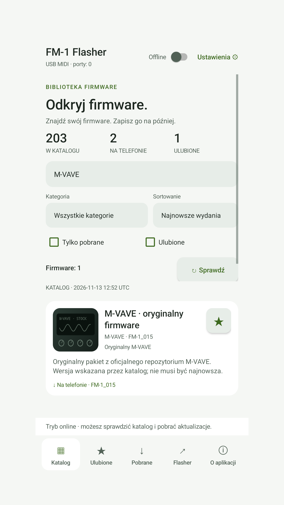

# FM-1 Flasher — instrukcja

FM-1 Flasher **0.10.2** oferuje lokalną bibliotekę firmware i sekwencyjną kolejkę instalacji. W sekcji **Urządzenia → MIDI i kopie zapasowe** możesz zapisywać i przywracać banki, ustawienia, sekwencje i presety. Narzędzia eksperymentalne umożliwiają zarządzanie bootloaderem, instalację firmware przez ROM i przywracanie pamięci tego samego urządzenia.

Niezależny menedżer firmware dla **M-VAVE FM-1** na Androida. Android obsługuje wiele instrumentów przez hub OTG, zapisując firmware **kolejno, na jednym instrumencie naraz**.

[English](../../README.md) · [简体中文](../zh-CN/documentation.md) · [Architektura](../../MIGRATION.md) · [Prywatność](privacy.md)

## Obsługiwane platformy

Wymagany jest Android 14+, USB Host/OTG i MIDI.

Identyfikator Androida to `pl.ekim.fm1_flasher`. Interfejs obsługuje polski, angielski i chiński uproszczony oraz motyw jasny, ciemny i systemowy.

<a id="getting-started"></a>
## Kolory instrumentów

W **Urządzenia → Szczegóły → Kolor instrumentu** wybierz jeden z sześciu nazwanych kolorów. Wybór zapisuje się od razu; można też zmienić kolor zapamiętanego, odłączonego FM1. Nazwy i znacznik zaznaczenia pozwalają korzystać z wyboru bez rozpoznawania samych barw.

Akcent pojawia się przy nazwie urządzenia na listach, w kolejce i historii oraz na jego pasku postępu flashowania. Kolory błędów i ostrzeżeń zachowują swoje znaczenie. Edycja koloru jest zablokowana podczas zajętości aplikacji oraz gdy urządzenie ma zadanie oczekujące lub uruchomione.

Ręczny wybór koloru zapamiętuje wpis także z domyślną nazwą. Kolor przetrwa restart aplikacji i ręczne przypisanie powracającego FM1. Nie identyfikuje sprzętu i nie włącza automatycznego parowania. Zadanie zachowuje kolor z chwili dodania do kolejki; późniejsza zmiana nie przemalowuje historii.

### Sprawdzenie bez sprzętu

Build debug zawiera osobną ikonę **FM1 Color Demo**. W szczegółach urządzenia zmienisz kolor. **Jasny / ciemny** przełącza motyw, a **Pokaż / wyczyść zadania** tworzy lub usuwa przykładowe stany, w tym stały postęp 47%. Wyczyść zadania przed kolejną zmianą kolorów. Kolory demo przetrwają restart w osobnych preferencjach. Demo nie łączy się z USB, nie zmienia właściwej floty i nie trafia do wariantu release.


## Pierwsza instalacja i plan aktualizacji

1. Zainstaluj APK 0.10.2 na Androidzie 14 lub nowszym. Aktualizacja wymaga tego samego certyfikatu podpisu; wersja Google Play może używać innego certyfikatu niż lokalny build testowy.
2. W **Bibliotece** znajdź firmware i pobierz paczkę z jej szczegółów. Pobranie sprawdza integralność, ale nie rozpoczyna instalacji.
3. Podłącz instrumenty przewodami do transmisji danych przez hub OTG. Zalecany jest hub z osobnym zasilaniem. Aplikacja nie mierzy jakości zasilania.
4. W **Urządzeniach** wybierz **Odczytaj instrument** na każdej karcie. Udziel systemowej zgody USB, gdy będzie potrzebna. Do planu można dodać rozpoznany FM-1.
5. W **Szczegółach** nadaj czytelną nazwę. Wskaż typ pamięci na podstawie znanego sprzętu i wybierz lokalną paczkę. Paczka zgodna z obydwoma wspieranymi typami pamięci może być dopuszczona także przy nieznanym typie kości; paczki jawnie niezgodne pozostają zablokowane; nieznana zgodność wymaga osobnego potwierdzenia wymuszenia opisanego poniżej.
6. Wybierz **Dodaj do planu** dla kolejnych instrumentów. Urządzenie może mieć jedno oczekujące lub wykonywane zadanie. Każdy instrument może otrzymać inną paczkę.
7. W **Zadaniach** sprawdź nazwy, wersje i sumy paczek, a następnie wybierz **Zainstaluj na N instrumentach**. Ten przycisk zatwierdza plan; zwykła instalacja nie wyświetla drugiego okna potwierdzenia.

Zachowaj połączenie USB i zasilanie do zakończenia weryfikacji. Jeżeli firmware udostępnia własny eksport danych, wykonaj kopię. Aktualizacja OTA nie robi automatycznej kopii; firmware może zmienić ustawienia instrumentu.

## Biblioteka i źródła

**Biblioteka** łączy wyszukiwanie, ulubione i pobrane paczki. **Tylko pobrane** i **Ulubione** są filtrami, a nie osobnymi zakładkami Androida. **Filtry i sortowanie** rozwija kategorię, kolejność i źródło. Przy aktywnym filtrze pobranych dostępna jest akcja aktualizacji paczek.

Szczegóły paczki pokazują wersję, autora/źródło, zgodność i SHA-256. Wybranie lokalnej paczki przenosi do Urządzeń; nie uruchamia zapisu. Zwykłe usunięcie poprawnej paczki można cofnąć w bieżącej sesji aplikacji. Paczki przypisanej do oczekującego lub aktywnego zadania nie można usunąć ani zastąpić: najpierw usuń oczekujące zadanie. Usunięcie paczki zachowuje ulubione.

Otwórz **Ustawienia → Źródła katalogu firmware**:

- **The Firmware Hub** jest domyślnie włączony, a **Awesome FM-1** wyłączony. [Awesome FM-1](https://github.com/ekim-pl/awesome-fm1) jest społecznościowym katalogiem projektów i odnośników do ich wydawców.
- Własne źródło może korzystać z katalogu HTTPS, wydań repozytorium GitHub lub adresu FWSC; wymaga nazwy, interwału 1–168 godzin i odpowiednich zakresów adresów paczek/grafik. **Zapisz** zapisuje konfigurację, a **Sprawdź teraz** jest osobnym działaniem. Nowe źródło jest początkowo wyłączone.
- Zaplanowane odświeżanie uwzględnia interwał także po błędzie. Buildy release domyślnie sprawdzają źródła co 8 godzin, a debug co godzinę; każde źródło zachowuje własne ustawienie. W trybie eksperymentalnym jawne sprawdzenie może pominąć interwał dla źródeł innych niż Firmware Hub, z zachowaniem opóźnień ponawiania narzuconych przez serwer. Firmware Hub zawsze zachowuje minimum 24 godzin. Ekran źródeł pokazuje błędy i termin kolejnego sprawdzenia.
- Wyłączone źródło nie wysyła automatycznych żądań. Można świadomie użyć Sprawdź teraz również dla wyłączonego źródła. Błąd zachowuje jego poprzednią kopię katalogu i nie blokuje pozostałych źródeł.
- Usunięcie własnej subskrypcji zachowuje paczki, ulubione, pochodzenie i poznane wycofania. Przywrócenie ustawień domyślnych włącza Hub i wyłącza Awesome FM-1 bez usuwania własnych subskrypcji.
- Sprawdzanie katalogów w tle jest opcjonalne i początkowo wyłączone. Sprawdza włączone katalogi przy odpowiednich warunkach sieciowych; nie zapisuje automatycznie paczek do biblioteki ani nie instaluje firmware; niektóre źródła pobierają bajty firmware w celu identyfikacji.

Tryb offline wyłącza sieciowe pobieranie katalogów, paczek i grafik oraz wstrzymuje sprawdzanie w tle. Zapisane firmware można instalować bez żądania sieciowego. Offline nie wykryje wycofania, którego lokalny katalog jeszcze nie zna. Deklaracje katalogu i sumy kontrolne same w sobie nie potwierdzają autentyczności wydawcy.

<a id="multiple-fm1-devices-on-a-hub"></a>
W **Ustawienia → Źródła firmware → Kolor źródła** wybierz jeden z ośmiu kolorów lub Automatyczny dla każdego źródła. Kropka przy nazwie źródła oznacza jego firmware w bibliotece, pobranych paczkach i szczegółach. Kolory są zapisywane na tym urządzeniu i można je zmieniać offline.

## Wiele FM-1 na hubie OTG

Karta ma lokalny rekord, nazwę/kolor, odczytaną tożsamość firmware, wybrany typ pamięci i bieżące połączenie. **Adres USB nie jest numerem fizycznego gniazda huba.** Model/wersja, VID/PID i typ kości JEDEC nie identyfikują jednoznacznie egzemplarza. Odczytane numery seryjne USB są lokalne; nie potwierdzono ich unikalności pomiędzy trybami FM-1.

Tylko jedno zadanie zmienia tryb naraz. Po restarcie aplikacja obserwuje USB/MIDI, wyklucza niezmienionych sąsiadów i wymaga jednego dopuszczalnego powrotu. Pozostałe obserwowane połączenia muszą zachować ciągłość. Przy wielu instrumentach użyj **powiązania na karcie zadania** wyłącznie dla aktualizowanego egzemplarza. Nie można obejść blokady, zgadując między kilkoma kandydatami. Nie zamieniaj nierozróżnialnych instrumentów podczas przejścia.

Automatyczne parowanie wielu urządzeń pozostaje wyłączone do testów sprzętowych. Zachowano ostrożny wariant automatyczny tylko przy braku sąsiadów MIDI oraz dokładnie jednym dopuszczalnym punkcie MIDI i jednym urządzeniu USB zgłaszanym przez Androida. Sam serial nie zezwala na automatyczne dopasowanie. Po odłączeniu i ponownym wykryciu system może ponownie wymagać zgody USB.

Utrata sąsiada, reset huba, zmiana generacji połączenia, sprzeczny serial lub niejednoznaczne porty zatrzymują dalszy zapis. Wiele par portów MIDI lub wiele punktów MIDI jednego urządzenia USB blokuje zapis. Potwierdzenie wyniku oznacza sprawdzenie powrotu i oczekiwanego modelu/wersji, a nie pełny odczyt porównawczy pamięci flash.

Nazwy przetrwają restart, ale powiązania z połączeniami nie przetrwają utraty procesu ani niewiarygodnego rozłączenia. Odczytaj i fizycznie rozpoznaj instrument, usuń dotknięte oczekujące zadania, a potem użyj **Zapisane instrumenty → Przypisz tę zapisaną nazwę**. Powiązanie resetuje dawny wybór pamięci; wskaż go ponownie przed ułożeniem planu.

## Zadania, zatrzymywanie i błędy

Zadanie utrwala cel i połączenie, oczekiwaną tożsamość, typ pamięci, klucz i hash paczki. Wszystkie paczki są sprawdzane przed pierwszym zapisem; każde zadanie jest sprawdzane ponownie przed własnym transferem. Zmiana wybranej paczki w interfejsie nie przekierowuje aktywnego zadania.

- **Zatrzymaj po tym instrumencie** dokończy bieżący zapis i weryfikację powrotu. Pozostałe zadania pozostaną w kolejce. Nie ma przycisku gwałtownego przerwania zapisu.
- Błąd zadania zatrzymuje przebieg. Przed nową próbą sprawdź instrument i szczegóły zadania. Paczka nie zostanie automatycznie przypisana innemu urządzeniu.
- Postęp i wyniki są w Zadaniach. Szczegóły pokazują pełny hash i czasy etapów. Trwała historia etapów obejmuje maksymalnie 64 wpisy na zadanie.
- Po utracie procesu aktywne zadanie staje się **niepotwierdzone**. Transfer nie wznawia się automatycznie od zapisanego procentu. Zadania oczekujące pozostają widoczne, lecz ich powiązania trzeba odbudować.
- Jeżeli plan nie odpowiada połączeniom lub paczkom, usuń dotknięte zadania, odczytaj instrumenty i dodaj nowe. Odmowa zgody USB nie upoważnia do zapisu.

Usługa pierwszoplanowa i ograniczony czasowo wake lock wspierają transfer przy zgaszonym ekranie lub innej aplikacji na wierzchu. Nie gwarantują zasilania USB ani ochrony przed każdą utratą procesu. Wróć do aplikacji, gdy potrzebne będzie powiązanie lub systemowa zgoda.

## Ustawienia i funkcje eksperymentalne

Ustawienia obejmują język/motyw, offline, źródła, O aplikacji i prywatność. **Funkcje eksperymentalne** są domyślnie wyłączone. Włączają Logger MIDI i narzędzia recovery; nie można zmieniać tego przełącznika w trakcie operacji. Zwykłe instalacje Androida wykonuje się przez Urządzenia i Zadania.

Pasywny logger MIDI ma ograniczone bufory i wybrane wejścia. Zatrzymuje się automatycznie przy łączeniu/zapisie; jednoczesne logowanie i flashowanie nie jest gwarantowane.

Włącz **Ustawienia → Funkcje eksperymentalne**, aby korzystać z diagnostyki, mapy sektorów, pełnych kopii, importu kopii i Loggera MIDI. Operacje ROM wymagają dokładnie jednego obsługiwanego FM-1 w trybie pobierania. Diagnostyka i kopie MBOOT wymagają wybranego urządzenia MIDI z obsługiwanym bootloaderem.

Pięć operacji zapisu pozwala instalować m-bootloader 2.4, przywracać fabryczny bootloader V15, instalować zgodne pobrane firmware przez ROM oraz przywracać kopię tego samego urządzenia z bootloaderem lub bez niego. Wybierz operację, **Przygotuj plan zapisu**, **Eksportuj kopię sprzed zapisu**, następnie **Zapisz sprawdzony plan** i potwierdź. Samo przygotowanie niczego nie zapisuje. Klucz fabryczny i MAC są chronione; kopia musi odpowiadać tożsamości urządzenia. Aplikacja weryfikuje sektory i całą pamięć, ale nie sprawdza uruchomienia. Nowo włączone operacje wymagają jeszcze prób sprzętowych; błąd zapisu bootloadera może wymagać sprzętowego odzyskiwania.

<a id="building-and-testing"></a>
## Budowanie i testy

Wymagane są JDK 17, Android SDK platform 36 i Build Tools 35.0.0. Wrapper ustala Gradle; projekt ustala AGP 8.13.2, Kotlin 2.2.21 i Compose 1.9.3. Skonfiguruj SDK lokalnie przez środowisko lub narzędzia Androida.

```sh
python3 tools/sync-resources.py --check
./gradlew :shared:jvmTest :app:testDebugUnitTest :app:lintDebug :app:assembleDebug :app:assembleDebugAndroidTest
```

APK: `app/build/outputs/apk/debug/app-debug.apk`. Testy: `app/build/outputs/apk/androidTest/debug/app-debug-androidTest.apk`. Katalog `dist/` jest ignorowany przez Git: przygotowana kopia buildu 23 jest lokalna i nie musi istnieć po sklonowaniu repozytorium.

Źródłem tłumaczeń interfejsu są XML w `app/src/main/res/values*`; po ich zmianie uruchom `python3 tools/sync-resources.py`. Dokumenty O aplikacji to `about/app*.md`, pakowane z licencjami przez `:app:bundleProjectDocs`. Główny README nie jest dokumentem O aplikacji.

Zobacz [architekturę i komendy testów](../../MIGRATION.md), [listę odbiorową](../../tests/android14-acceptance.txt) i [budowanie witryny](pages.md). [Odziedziczone workflow Google Play wskazują inny identyfikator aplikacji](github-actions.txt); publikacja jest osobnym działaniem.

## Planowany port na iOS

Port na iOS jest planowany w przyszłości. Nie ma jeszcze wydania na iOS ani ogłoszonego terminu.

## Zakres weryfikacji

W buildzie 23 zaliczono **191 testów jednostkowych (62 shared + 129 Android JVM)**; cztery testy zewnętrznych fixture’ów pominięto. Zaliczone są **44 testy instrumentacyjne Androida**, w tym eksport/czyszczenie logu, czyszczenie biblioteki i potwierdzenia w trzech językach. Przeszły debug, lint i kompilacja metadanych iOS. Właściciel potwierdził działanie buildu 20 na fizycznych FM-1; nowych funkcji i wszystkich kombinacji sprzętu nie zweryfikowano fizycznie.

Nie sprawdzono fizycznego FM-1/huba ani aplikacji iOS. Zasilanie, rzeczywiste przejścia trybów/deskryptorów, unikalność seriali i pełny zapis sprzętu pozostają warunkami odbioru. [Raport buildu 0.10.1](../../publication/qa/0.10.1.txt) zawiera identyfikację pliku i zakres prób.

## Prywatność i autorstwo

Bez konta i reklam. Wersja F-Droid nie zawiera SDK analityki; wersja Google Play z Firebase domyślnie zbiera statystyki; wyłączysz je w Ustawienia → Statystyki użytkowania. Biblioteka, nazwy, odczytane seriale, wybory pamięci i historia zadań pozostają lokalnie. Serwery katalogów/grafik/paczek otrzymują metadane połączenia; aplikacja nie dołącza tożsamości instrumentów do tych żądań. Szczegóły: [polityka prywatności](privacy.md).

Kod aplikacji: [MIT](../../LICENSE.md). Katalog [The Firmware Hub](https://thefirmwarehub.com): CC BY 4.0; firmware zachowuje licencje autorów. [Awesome FM-1](https://github.com/ekim-pl/awesome-fm1) jest opcjonalnym katalogiem. Informacje o zależnościach: [third_party](../../third_party/). Kontakt: [ekim.pl@gmail.com](mailto:ekim.pl@gmail.com).

## Diagnostyka i czyszczenie pamięci

Aplikacja stale zapisuje lokalny log operacji (pliki dzienne, domyślnie siedem dni; do 256 KiB dziennie i 10 MiB łącznie). Log przetrwa restart aplikacji i zawiera czas, działania, zmiany portów USB/MIDI, etapy instalacji oraz przechwycone błędy. Nie zapisuje surowego ruchu MIDI ani plików firmware. Włącz **Ustawienia → Funkcje eksperymentalne**, aby użyć **Eksportuj log operacji** (JSON Lines, `.jsonl`) i **Wyczyść log operacji**. Eksport otwiera systemowy wybór pliku; log nie jest automatycznie wysyłany. Czyszczenie wymaga jednego potwierdzenia i nie usuwa wcześniej wyeksportowanych kopii. Kolejne zdarzenia są nadal zapisywane. Osobny Logger MIDI służy do podglądu surowego ruchu MIDI.

**Ustawienia → Wyczyść pobrane firmware** usuwa po jednym potwierdzeniu wszystkie pobrane paczki i metadane, w tym uszkodzone i osierocone pliki. Czyści wybór paczki i możliwość cofnięcia pojedynczego usunięcia. Zachowuje ulubione, źródła katalogu, nazwy instrumentów, historię zadań i kopie odzyskiwania. Najpierw usuń oczekujące zadania; czyszczenie jest blokowane podczas pracy oraz przy paczkach przypisanych do oczekujących/trwających zadań. Instalacja offline wymaga ponownego pobrania paczek.

**Urządzenia → Tryby i kość pamięci** rozdziela odczyt MIDI, przejście w tryb download i wykrywanie kości na czytelne karty. Wynik detekcji otwiera popup. Potem wyłącz i włącz instrument, aby wrócić do MIDI. Domyślne odłączone wpisy są tymczasowe; własne nazwy, ręcznie wybrane kolory i cele kolejki pozostają. Opóźnione odłączenie poprzedniego portu USB nie przerywa kolejnego etapu tej samej aktualizacji. Utrata innego instrumentu lub huba nadal blokuje zapis.

## Pełnoekranowe ustawienia

**Ustawienia** są pełnym ekranem z kartami Interfejs, Biblioteka firmware, Funkcje eksperymentalne i Aplikacja. Język oraz motyw wybiera się bezpośrednio przyciskami radiowymi. Źródła, formularze, zgodność poszczególnych paczek i polityka prywatności otwierają się jako pełne strony. Nagłówek i systemowe Wstecz cofają o poziom; poprzednia zakładka Biblioteka/Urządzenia/Zadania i niesekretne dane formularza przetrwają odtworzenie aktywności. Wpisane hasła/tokeny nie są zapisywane w stanie aktywności. Okna pozostają przy potwierdzeniach usuwania i żądanym wyniku wykrywania kości.

## Providery katalogów i uwierzytelnianie

Android używa adapterów wspólnego interfejsu `CatalogProvider`:

| Provider | Działanie |
| --- | --- |
| `thefirmwarehub` | Wbudowany katalog JSON Firmware Hub i dotychczasowe zasady pobierania |
| `awesome-fm1` | Wbudowany katalog JSON Awesome FM-1 i zatwierdzone zakresy URL |
| `repo-url` | Repozytorium GitHub.com, opublikowane wydania/prerelease i załączniki `.fwsc`; bez draftów |
| `pkg-url` | Bezpośredni adres HTTPS `.fwsc`, identyfikacja i suma z faktycznego pliku |

Adapter `catalog-json` zachowuje dotychczasowe niestandardowe subskrypcje JSON. Stare identyfikatory źródeł, ulubione, pobrane paczki i historia pozostają. Zapisz ręczne źródło, wybierz **Sprawdź teraz** i włącz je, aby udostępnić jego oferty. Import ma limity; błąd lub niepełne pobranie zachowuje poprzedni katalog. Paginacja i paczki GitHub respektują opóźnienia ponowienia. Duże repozytoria mogą wymagać uwierzytelniania z powodu limitów GitHub.

Gdy GitHub udostępnia SHA-256 załącznika, aplikacja używa tej sumy i odczytuje początek paczki w celu ustalenia produktu. Starsze załączniki bez sumy wymagają pobrania i walidacji paczki, aby obliczyć hash. Sprawdzanie bezpośredniego pliku również pobiera i weryfikuje paczkę. Sprawdzanie może więc przesyłać dane binarne bez oznaczania paczki jako pobranej do pracy offline. **Pobierz** nadal zapisuje ją w bibliotece; instalacja nie rozpoczyna się automatycznie.

Ręczne providery nie zgadują zgodności kości z nazw plików. Po sprawdzeniu źródła otwórz **Edytuj → Zgodność poszczególnych paczek**, potwierdź informacje autora dla konkretnego SHA-256, wróć i zapisz. Deklaracja aktualizuje metadane pasujących bajtów, także lokalnej kopii; nie obejmuje innego pliku pod tym samym URL-em ani innego wydania. Nieznana zgodność blokuje instalację. Brak deklaracji nie jest sprzecznością ze znanymi danymi; sprzeczne jawne deklaracje tożsamości/kości nadal blokują użycie.

Formularz źródła oferuje brak uwierzytelniania, HTTP Basic, Bearer, klucz API we wskazanym bezpiecznym nagłówku i OAuth 2.0. Basic przyjmuje użytkownika/hasło, Bearer sam token bez prefiksu `Bearer`. Klucz API wysyła wartość nagłówka dosłownie, w tym własny prefiks przy nagłówku `Authorization`. Hasła, tokeny i client secret są szyfrowane kluczem Android Keystore, poza metadanymi SQLite, i nie trafiają do logu. Puste pole zachowuje sekret tylko dla niezmienionego źródła/providera/tożsamości uwierzytelniania; inny URL nie dziedziczy go. Usunięcie źródła i odtworzenie ustawień wbudowanych usuwa odpowiednie sekrety.

Przed autoryzacją zarejestruj poniższy adres u dostawcy. Przy aktualizacji starszej instalacji sprawdź zarejestrowany adres i rozpocznij ponownie oczekujące logowanie.

OAuth obsługuje logowanie w przeglądarce Authorization Code z **PKCE S256** oraz usługowy **Client Credentials**. Skonfiguruj serwer, client ID, zakresy, endpoint tokenów i — dla przeglądarki — endpoint autoryzacji. Zarejestruj `pl.ekim.fm1-flasher://oauth/callback` w serwerze. Client Credentials wymaga client secret, publiczny klient PKCE nie. Wybierz `client_secret_basic` lub `client_secret_post` zgodnie z serwerem. Zapisz źródło i wybierz **Autoryzuj OAuth 2.0** na jego karcie. Wygasłe tokeny są odświeżane, gdy serwer zwróci refresh token; Client Credentials może uzyskać nowy token. Stan przeglądarkowego logowania jest jednorazowy, przypisany do źródła/rewizji i wygasa po dziesięciu minutach. Aplikacja nie zawiera uniwersalnego client ID ani sekretu.

Uwierzytelnienie jest ograniczone do pochodzenia źródła (API GitHub dla `repo-url`). Przy zmianie domeny w przekierowaniu, także do CDN, jest usuwane; przekierowania POST tokenów są odrzucane. Nadal obowiązuje HTTPS oraz kontrola publicznych adresów i zakresów URL. Interwał źródła można ustawić od 1 do 168 godzin. Buildy release domyślnie używają 8 godzin, a debug 1 godziny. W trybie eksperymentalnym jawne sprawdzenie może pominąć interwał dla źródeł innych niż Hub; opóźnienia ponawiania serwera nadal obowiązują, a Hub zachowuje minimum 24 godzin. Jawna zmiana sekretu lub ukończona autoryzacja pozwala na nowe sprawdzenie.


## Wymuszenie przy nieznanej zgodności

Lista pamięci pokazuje opisy: **Starsza pamięć** obsługuje starsze firmware, a **Nowsza pamięć** wymaga firmware z jawną obsługą nowej kości. **Nie znam** oznacza nierozpoznany typ pamięci instrumentu. Sama wersja firmware nie określa kości.

Zwykła instalacja zachowuje ostrożne reguły. Gdy typ kości instrumentu jest nieznany, a paczka obsługuje tylko starszą pamięć, albo paczka ma `chip: unknown`, wybierz **Wymuś instalację (nieznana zgodność)**. Sprawdź instrument, wersję paczki i SHA-256, przeczytaj dodatkowe ostrzeżenie, zaznacz akceptację ryzyka i potwierdź. Na Androidzie powstanie wyraźnie oznaczone zadanie; przejrzyj plan w **Zadaniach** i uruchom instalację. Zgoda zostaje tylko przy tym zadaniu, nigdy jako ustawienie globalne. Na iOS po dodatkowym ostrzeżeniu pojawia się zwykłe potwierdzenie instalacji.

Niewłaściwy firmware może uniemożliwić uruchomienie instrumentu i wymagać naprawy sprzętowej. Sprawdź zgodność u autora i zrób kopię danych. Wymuszenie nie omija jawnej niezgodności (paczka tylko dla starszej pamięci przy znanej nowszej kości), niewspieranych, wycofanych lub sprzecznych paczek, kontroli hash/produktu ani weryfikacji urządzenia i ponownego połączenia. Po usunięciu zadania kolejna wymuszona próba wymaga nowej zgody.

Odnośniki do licencji w O aplikacji otwierają pełnoekranowy widok **Licencja**. Przycisk w nagłówku i systemowe Wstecz wracają do O aplikacji; teksty licencji są dostępne offline.

## Zrzuty ekranu

[](../../fastlane/metadata/android/pl-PL/images/phoneScreenshots/01.png)


Historia zakończonych zadań jest domyślnie przechowywana przez 30 dni. W Ustawieniach można zmienić okres lub wyczyścić zakończoną historię. Zadania oczekujące i trwające, backupy oraz zapis nierozstrzygniętej sesji są chronione. Logi diagnostyczne można przechowywać przez 7, 14 lub 30 dni. Starsze logi są usuwane przy zapisie lub odczycie; nieużywana aplikacja sprząta przy kolejnej aktywności. Ręczne czyszczenie usuwa zachowane pliki dzienne, ale nie wyeksportowane kopie.


## Kopie i plan zapisu w 0.10.1

Narzędzia ROM odczytują pełne 1 MiB dwukrotnie i zapisują kopię tylko przy zgodności odczytów. MBOOT MIDI dodatkowo sprawdza CRC32 urządzenia. Diagnostyka pokazuje ID pamięci, klucz układu, pojemność, wersję loadera i UID, jeśli dostępny. Klucz układu nie jest numerem seryjnym. Mapa przedstawia 256 sektorów po 4 KiB; nieznane miejsce nie oznacza wolnego obszaru.

Importuj ZIP aplikacji lub wybierz razem BIN 1 MiB i jego plik JSON. Brak tożsamości lub metadanych integralności pozwala tylko na analizę. Instalacja firmware i fabrycznego bootloadera używa paczki wybranej w Bibliotece; przywracanie używa aktualnie analizowanej kopii. Bootloader 2.4 jest dołączony i sprawdzany hashem. Przywracanie fabrycznego bootloadera wymaga zatwierdzonej paczki V15 i obejmuje pełną konfigurację.

Obsługiwane ID pamięci to Puya `0x856014` i UCUN `0xB36014`, przy kluczu FM-1 i poprawnym układzie danych. Po przygotowaniu wyeksportuj nową kopię; anulowanie lub błąd eksportu nie odblokuje zapisu. Ponowne podłączenie lub zmiana wybranej paczki wymaga nowego planu. Przed kasowaniem aplikacja ponownie porównuje całą pamięć z kopią. Zapisuje wyłącznie zmienione sektory i zatrzymuje się po błędzie bez automatycznej próby ponowienia ani restartu. Wynik i kopia pozostają lokalnie.

Przywracanie kopii wymaga zgodnego UID, kości, klucza i danych fabrycznych. Opcja zachowania bootloadera go nie zmienia; drugi wariant jawnie go przywraca. Zwykła instalacja ROM zachowuje bootloader. Ograniczone recovery V15 pozostaje osobną akcją. Zmiana układu danych lub downgrade może utracić brzmienia i presety; sam powrót do starszego firmware ich nie odtwarza.
