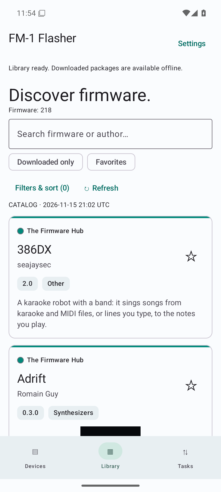
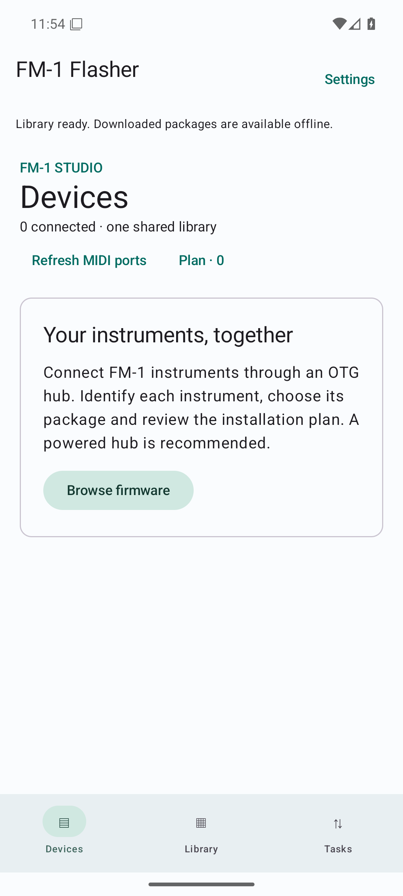
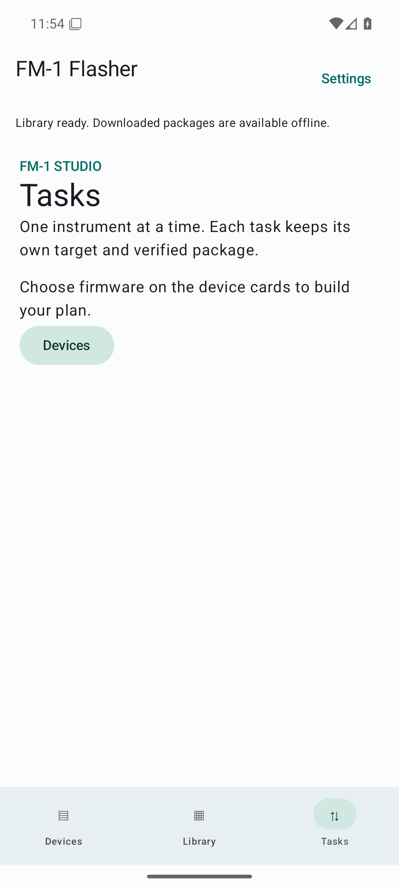
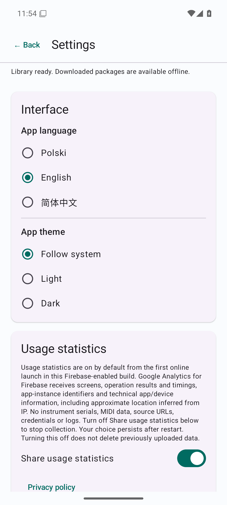
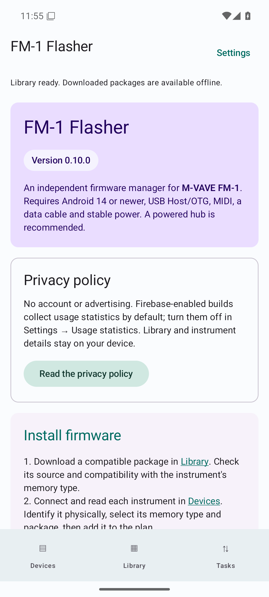
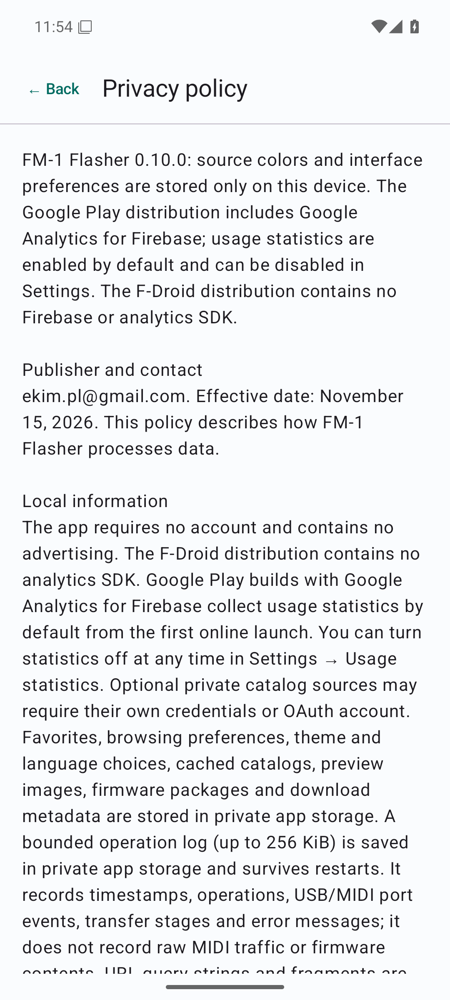
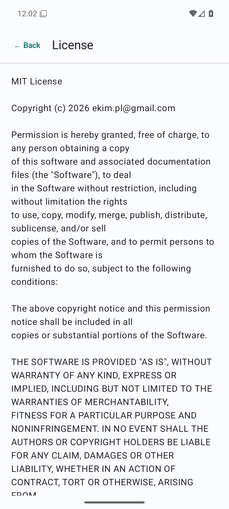
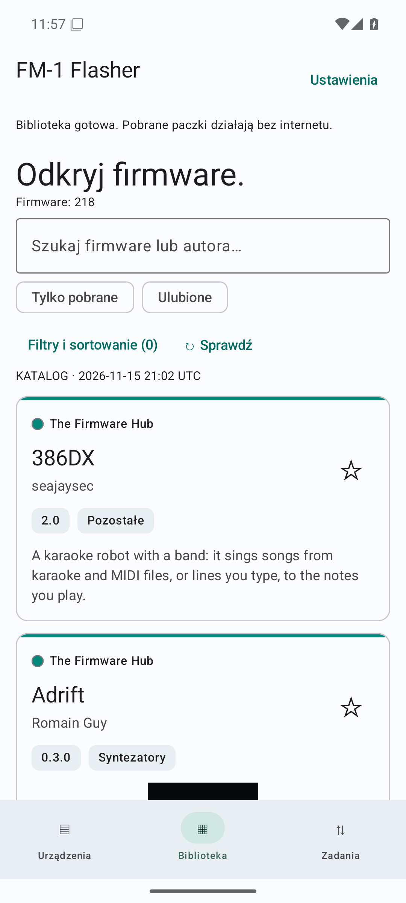
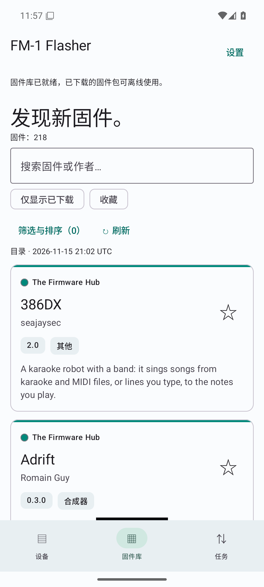

# Galeria ekranów

FM-1 Flasher **0.10.0 / 31**, Android 16, 1080 × 2400. To rzeczywiste ekrany wariantu testowego Google Play z testowym projektem Firebase. Urządzenia i Zadania pokazują stan bez podłączonego sprzętu; nie symulujemy aktualizacji. Opisy firmware pozostają w językach autorów. Kliknij obraz, aby otworzyć oryginalny PNG.

## Interfejs angielski

  
**Biblioteka — wyszukiwanie, kolory źródeł i karty firmware**

  
**Urządzenia — bez podłączonego instrumentu**

  
**Zadania — pusty plan instalacji**

  
**Ustawienia — język, motyw i statystyki użytkowania**

  
**O aplikacji — wersja 0.10.0**

  
**Prywatność — warianty Google Play i F-Droid**

  
**Licencja — dołączony tekst MIT**

## Pozostałe języki interfejsu

  
**Biblioteka po polsku**

  
**Biblioteka po chińsku uproszczonym**
