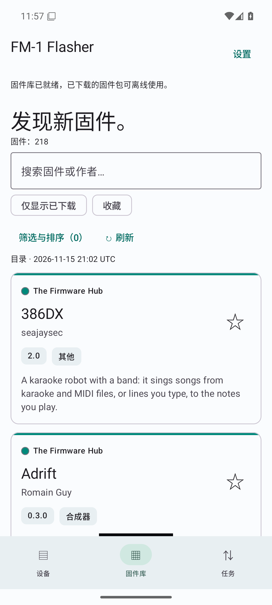

# FM-1 Flasher 使用指南

FM-1 Flasher **0.10.1** 包含本地固件库、来源颜色、全屏设置和顺序安装任务。实验性工具新增闪存诊断、备份导入、引导程序管理、ROM 固件安装及同设备备份恢复。

面向 **M-VAVE FM-1** 的独立固件管理器，适用于 Android。Android 可通过 OTG 集线器管理多台乐器，并且**每次只写入一台乐器**。

[English](../../README.md) · [Polski](../pl/documentation.md) · [实现说明](../../MIGRATION.md) · [隐私](privacy.md)

## 平台支持

需要 Android 14+、USB Host/OTG 和 MIDI。

Android 应用 ID 是 `pl.ekim.fm1_flasher`。界面支持英语、波兰语和简体中文，以及浅色、深色和跟随系统主题。

<a id="getting-started"></a>
## 乐器颜色

在 **设备 → 详情 → 乐器颜色** 中选择六种命名颜色之一。选择会立即保存，也可以修改已断开的已保存设备。颜色名称和选中标记让操作不依赖于辨别颜色。

颜色标记显示在已连接/已保存设备列表、队列及历史中的设备名称旁，并用于该设备的写入进度条。错误和警告仍使用原来的提示颜色。应用忙碌或设备有排队/运行中的任务时，颜色编辑不可用。

手动选择颜色也会记住仍使用默认名称的设备。应用重启及手动重新配对后仍保留颜色。颜色只是视觉标签，不代表硬件身份，也不会启用自动配对。任务保存加入队列时的颜色，之后修改设备颜色不会改变历史记录。

### 无硬件体验

Debug 构建包含独立的 **FM1 Color Demo** 启动图标。在设备详情中选择颜色；**Jasny / ciemny** 切换明暗主题，**Pokaż / wyczyść zadania** 显示或清除示例任务，包括固定的 47% 进度。再次修改颜色前先清除任务。演示颜色通过独立的本地设置保存，重启后仍保留。演示不连接 USB，也不修改真实设备列表；release 构建不包含演示。


## 开始使用

1. 在 Android 14 或更高版本安装 0.10.1 APK。更新需要相同的签名证书；Google Play 版本的证书可能与本地测试构建不同。
2. 在**固件库**查找固件，从详情下载。下载会校验固件包，不会开始安装。
3. 使用支持数据传输的线缆，通过 OTG 集线器连接乐器。建议独立供电；应用不能测量或保证集线器供电质量。
4. 在**设备**中逐台选择**读取乐器信息**，按需授予 Android USB 权限。只有识别为 FM-1 的设备才能加入计划。
5. 在**详情**设置易于识别的名称。根据已知硬件信息选择存储芯片类型，并为每台设备选择本地固件。兼容两种支持芯片的固件包可在芯片类型未知时获准；明确不兼容的包仍会被阻止；兼容性未知时需要下文所述的单独强制确认。
6. 为各乐器选择**添加到计划**。每台设备只能有一个待处理或正在执行的任务；不同设备可选择不同固件包。
7. 在**任务**检查名称、版本和哈希，点击**在 N 台乐器上安装**。这一步批准整个计划，普通安装不会再显示第二个确认对话框。

在验证完成前保持电源和 USB 连接。若固件提供数据导出工具，请先备份。OTA 更新不会自动备份，固件可能改变乐器设置。

## 固件库和来源

**固件库**集中管理搜索、收藏和下载。**仅已下载**与**收藏**是筛选条件，并非独立 Android 导航页。**筛选与排序**展开类别、排序和来源控件。启用已下载筛选时，可使用固件包更新操作。

详情显示版本、作者/来源链接、兼容性和 SHA-256。选择已保存固件会返回设备页，不会立即写入。有效固件包的普通删除可在当前应用会话内撤销。被待处理或正在执行的任务引用的包不能删除或替换；先移除待处理任务。删除包不会删除收藏。

打开**设置 → 固件目录来源**：

- **The Firmware Hub** 默认启用，**Awesome FM-1** 默认关闭。[Awesome FM-1](https://github.com/ekim-pl/awesome-fm1) 是指向固件项目与发布者的社区目录。
- 自定义来源需要 HTTPS 目录、支持的 Hub 风格 JSON 格式、名称、1–168 小时检查间隔及批准的固件包/图片 URL 范围。**保存**仅保存配置；**立即检查**是独立操作。新来源默认关闭。
- 计划刷新会遵守来源间隔，失败尝试也计入。release 构建默认每 8 小时检查，debug 构建默认每 1 小时检查；每个来源保留自己的设置。在实验模式下，手动检查可为 Hub 以外的来源绕过间隔，但仍遵守服务器重试延迟。Firmware Hub 始终至少间隔 24 小时。来源页显示错误及下次允许检查的时间。
- 关闭的来源不会自动请求，但可以明确执行立即检查。来源失败时保留其缓存快照，不阻止其他来源更新。
- 删除自定义订阅会保留固件包、收藏、来源记录及已知撤回信息。恢复默认设置会启用 Hub、关闭 Awesome FM-1，而不移除自定义订阅。
- 后台目录检查默认关闭。启用后在网络条件允许时检查已启用目录，不会自动保存离线固件包或安装固件；部分来源会获取固件字节用于识别。

离线模式阻止目录、固件包及图片的网络请求，并暂停后台检查。已保存固件可在没有网络请求的情况下写入。离线无法发现尚未同步到本地的撤回信息。目录声明和哈希本身不能证明发布者真实性。

<a id="multiple-fm1-devices-on-a-hub"></a>
在**设置 → 固件来源 → 来源颜色**中，为每个来源选择八种颜色之一或“自动”。来源名称旁的圆点标记固件库、已下载固件包及详情中的固件。颜色保存在本设备，可离线更改。

## OTG 集线器上的多台 FM-1

设备卡片包含本地记录、名称/颜色、已读取的固件标识、芯片选择与当前连接。**USB 地址不是集线器的物理端口号。**型号/版本、VID/PID 和 JEDEC 芯片类型不能唯一识别乐器。已读取的 USB 序列号仅保存在本地，其跨 FM-1 模式的唯一性尚未经硬件验证。

一次只有一个任务切换模式。计划内重启后，应用观察 USB/MIDI 事件，排除未变化的邻居，并要求只有一个合格的返回设备。其他已观察连接必须始终连续。多设备情况下，仅为正在更新的乐器使用**任务卡片内的配对操作**；不能在多个候选设备中猜测并强行继续。切换期间不要交换无法区分的设备。

多设备自动配对保持关闭，等待实机测试。保留的保守自动路径仅适用于没有 MIDI 邻居、Android 报告一个合格 MIDI 端点和一个 USB 设备的情况。单靠序列号不会批准自动配对。断开并重新枚举后，系统可能再次要求 USB 权限。

邻居断开、集线器重置、连接代次变化、序列号冲突或端口不明确都会停止后续写入。一个 USB 设备提供多对 MIDI 端口或多个 MIDI 端点时禁止写入。确认结果表示已检查重连及预期型号/版本，不代表完整闪存回读比对。

保存的名称会保留，但进程结束或连接失去可信连续性后，不会保留活连接绑定。重新读取并实际辨认乐器，移除相关待处理任务，然后在**已保存的乐器**中关联名称。重新配对会重置旧芯片选择；建立新计划前需再次指定。

## 任务、停止与故障

任务固定目标记录/连接、预期身份、芯片选择、固件包键与哈希。首次写入前检查计划内所有包；各任务传输前再次检查。更改界面当前选择的固件不会改变正在执行任务的目标。

- **处理完此乐器后停止**会完成当前写入和重连验证，其余任务仍在队列中。没有突然中止活跃写入的按钮。
- 一个任务失败即停止本次执行。再次尝试前检查乐器与任务详情；其固件不会自动分配给其他设备。
- 任务页保留进度和结果，详情显示完整哈希和阶段时间。每个任务最多保存 64 个阶段记录。
- 进程中断后，活跃任务标为**未确认**。不会从保存的百分比自动恢复传输。待处理任务仍可见，但必须重建旧连接绑定。
- 若计划与当前连接或固件不符，请移除相关任务，重新读取乐器并添加新任务。USB 权限被拒绝不代表允许写入。

Android 前台服务和限时 wake lock 支持熄屏或切换应用后的活跃传输，但不能保证 USB 供电或避免所有系统/进程中断。需要配对或系统授权时请返回应用。

## 设置与实验功能

设置提供语言/主题、离线、来源、关于与隐私。**实验功能**默认关闭；开启后显示 MIDI 日志与恢复工具。忙碌操作期间不能更改此开关。普通 Android 安装通过设备和任务页执行。

只接收的 MIDI 日志具有有界缓冲区和所选输入，连接/写入时自动停止；不承诺同时记录和刷写。

启用**设置 → 实验功能**可使用闪存诊断、扇区图、完整备份、备份导入和 MIDI 日志。ROM 操作要求仅连接一台处于下载模式的受支持 FM-1。MBOOT 诊断和备份要求选择运行受支持引导程序的 MIDI 设备。

五种写入操作包括安装 m-bootloader 2.4、恢复原厂 V15 引导程序、通过 ROM 安装兼容的已下载固件，以及保留或同时恢复引导程序的同设备备份恢复。选择操作后，依次使用**准备写入计划**、**导出写入前备份**、**写入已审阅计划**并确认。仅准备计划不会写入。出厂密钥和 MAC 始终受保护，备份必须与设备身份匹配。应用会验证每个扇区和完整闪存，但不会验证启动。新启用的写入仍需实机验收；引导程序写入失败可能需要硬件恢复。

<a id="building-and-testing"></a>
## 构建与测试

需要 JDK 17、Android SDK platform 36、Build Tools 35.0.0。Gradle 由 wrapper 固定；AGP 为 8.13.2、Kotlin 为 2.2.21、Compose 为 1.9.3。通过本地环境或 Android 工具配置 SDK。

```sh
python3 tools/sync-resources.py --check
./gradlew :shared:jvmTest :app:testDebugUnitTest :app:lintDebug :app:assembleDebug :app:assembleDebugAndroidTest
```

APK：`app/build/outputs/apk/debug/app-debug.apk`。测试 APK：`app/build/outputs/apk/androidTest/debug/app-debug-androidTest.apk`。`dist/` 被 Git 忽略；构建 23 的预备副本是本地文件，新克隆不保证包含它。

界面翻译以 `app/src/main/res/values*` XML 为准。修改后运行 `python3 tools/sync-resources.py`。应用内关于文档是 `about/app*.md`，通过 `:app:bundleProjectDocs` 与许可证一起打包；根 README 不是应用内关于文档。

另见[架构与测试命令](../../MIGRATION.md)、[验收清单](../../tests/android14-acceptance.txt)及[网站构建](pages.md)。[继承的 Google Play 工作流仍指向不同应用 ID](github-actions.txt)，发布是独立步骤。

## 未来的 iOS 移植

未来计划推出 iOS 移植版。目前没有 iOS 版本，也未公布发布日期。

## 验证范围

构建 23 通过 **191 个单元测试（62 shared + 129 Android JVM）**，另有四个外部 fixture 测试跳过；**44 个 Android 仪器化测试**通过，包括日志导出/清除、固件库清理和三种语言的确认流程。Debug、lint 和 iOS 元数据编译通过。所有者报告构建 20 已在实体 FM-1 上正常运行，新功能与所有硬件组合仍需单独验证。

未测试物理 FM-1/集线器或 iOS 二进制。供电、真实模式/描述符变化、序列号唯一性及完整硬件写入仍是验收条件。[构建报告](../../publication/qa/0.10.1.txt)提供文件身份和测试范围。

## 隐私与署名

无需账户且无广告。F-Droid 版本不含分析 SDK；Google Play 构建默认收集使用统计，可在“设置 → 使用统计”中关闭。固件库、名称、序列号观察值、芯片选择和任务历史保存在本地。外部目录/图片/下载服务器收到连接元数据，应用不会附加乐器身份。详见[隐私政策](privacy.md)。

应用代码：[MIT](../../LICENSE.md)。[The Firmware Hub](https://thefirmwarehub.com) 目录使用 CC BY 4.0，固件遵循其作者的许可证。[Awesome FM-1](https://github.com/ekim-pl/awesome-fm1) 是可选目录。依赖声明见 [third_party](../../third_party/)。联系：[ekim.pl@gmail.com](mailto:ekim.pl@gmail.com)。

## 诊断与存储清理

应用始终在本地保存操作日志（按日保存，默认保留七天；每天最多 256 KiB，总计最多 10 MiB），重启后保留。日志包括时间、操作、USB/MIDI 端口变化、安装阶段和捕获的错误，不记录原始 MIDI 流量或固件字节。在**设置 → 实验功能**中使用**导出操作日志**（JSON Lines，`.jsonl`）或**清除操作日志**。导出打开系统文件选择器，不会自动上传。清除需一次确认，不会删除已导出的文件，后续事件仍会继续记录。独立的 MIDI 日志工具用于实时原始 MIDI 诊断。

**设置 → 清除已下载固件**在一次确认后删除全部下载包与元数据，包括损坏及孤立文件，并清除当前选择和单包撤销记录。收藏、目录来源、乐器名称、任务历史和恢复备份保留。请先删除排队任务；操作进行中或存在排队/运行任务时禁止清理。离线安装前必须重新下载固件。

**设备 → 模式与闪存芯片**提供分开的 MIDI 读取、下载模式和芯片检测卡片。检测成功会弹窗显示结果，之后关闭并重新开启乐器以返回 MIDI 模式。默认离线条目是临时的，自定义名称、手动选择的颜色和排队目标会保留。来自同次更新旧端口的延迟 USB 断开事件不会中止下一阶段；其他乐器或集线器断开仍会阻止写入。

## 全屏设置

**设置**使用完整页面，并分为界面、固件库、实验功能和应用卡片。语言与主题直接通过单选项选择。来源列表、来源编辑、各固件包兼容性和隐私政策均使用完整页面。顶部返回和系统返回逐级导航；原先的固件库/设备/任务页及非敏感表单草稿在活动重建后保留。密码和令牌输入不会保存到活动状态。仅删除确认和芯片检测结果仍使用弹窗。

## 目录提供程序与认证

Android 适配器实现共享的 `CatalogProvider` 接口：

| Provider | 行为 |
| --- | --- |
| `thefirmwarehub` | 内置 Firmware Hub JSON 目录及现有下载策略 |
| `awesome-fm1` | 内置 Awesome FM-1 JSON 目录及批准的 URL 范围 |
| `repo-url` | GitHub.com 仓库的正式发布、预发布及 `.fwsc` 附件，不含草稿 |
| `pkg-url` | 直接 HTTPS `.fwsc` 地址，从实际文件识别产品并计算哈希 |

`catalog-json` 适配器保留原有自定义 JSON 订阅。旧来源 ID、收藏、下载和历史不会删除。保存手动来源后，选择**立即检查**并启用来源以显示其固件。导入有边界限制，失败或未完成的导入保留旧快照。GitHub 分页与附件请求遵守重试延迟；大型仓库可能因 GitHub 限额需要认证。

如果 GitHub 提供 SHA-256，则使用该值并读取固件包前缀来识别产品。缺少摘要的旧附件需要下载并验证完整固件包以计算哈希。检查直接固件包同样会下载并验证文件。因此检查来源可能传输二进制数据，但不会将其标记为离线下载；仍需选择**下载**保存到固件库，不会自动安装。

手动来源不会从文件名推断芯片兼容性。检查来源后，打开**编辑 → 各固件包兼容性**，依据发布者信息为具体 SHA-256 声明兼容性，然后返回并保存。声明仅更新相同字节的元数据，包括匹配的本地副本；同一 URL 的其他文件或不同版本不会继承声明。未知兼容性阻止正常安装，强制安装需要单独的警告和风险确认；未知并非与已知数据矛盾，明确的产品或芯片声明冲突仍会阻止使用。

来源表单支持无认证、HTTP Basic、Bearer、指定安全请求头的 API 密钥和 OAuth 2.0。Basic 使用用户名/密码；Bearer 输入令牌本身，不含 `Bearer` 前缀。API 密钥按原样发送请求头值，使用 `Authorization` 时可包含自己的前缀。密码、令牌和客户端密钥由 Android Keystore 密钥加密，与 SQLite 元数据分开，不写入日志。来源、提供程序和认证身份不变时留空可保留已保存的秘密；其他 URL 不会继承。删除来源或恢复内置默认值会移除对应凭据。

授权前请向服务商注册下方回调地址。升级旧安装时，请检查已注册的回调地址，并重新开始尚未完成的登录。

OAuth 支持浏览器 Authorization Code **PKCE S256** 与服务 **Client Credentials**。配置发行者、客户端 ID、权限范围、令牌端点，以及浏览器模式的授权端点。向服务器注册 `pl.ekim.fm1-flasher://oauth/callback`。Client Credentials 需要客户端密钥，公共 PKCE 客户端不需要。依据服务器选择 `client_secret_basic` 或 `client_secret_post`。保存后在来源卡片选择 **OAuth 2.0 授权**。有刷新令牌时自动刷新过期令牌，Client Credentials 可重新获取令牌。浏览器状态一次性使用，绑定来源和修订，十分钟后过期。应用没有内置通用客户端 ID 或密钥。

认证只发送给配置的来源原点（`repo-url` 使用 GitHub API 原点）。跨原点跳转（包括 CDN）不携带认证；令牌 POST 跳转会被拒绝。仍要求 HTTPS、公共地址和批准的 URL 范围。来源间隔可设为 1–168 小时。release 构建默认 8 小时，debug 构建默认 1 小时。实验模式下，手动检查可为 Hub 以外的来源绕过间隔；服务器重试延迟仍然有效，Hub 始终至少间隔 24 小时。明确替换凭据或完成授权后可重新检查。


## 兼容性未知时强制安装

闪存选择器显示说明：**旧版闪存**支持旧版固件；**新版闪存**需要明确支持新版芯片的固件。**未知**表示尚未识别设备的闪存类型，固件版本本身不能确定芯片类型。

正常安装仍采用保守规则。当设备芯片未知且固件包仅支持旧版闪存，或固件包声明 `chip: unknown` 时，可选择**强制安装（兼容性未知）**。检查设备、版本和 SHA-256，阅读额外警告，勾选风险确认并确认操作。Android 会添加带有强制标记的任务；请在**任务**中审查计划并明确开始安装。授权仅保存在该任务中，不是全局设置。iOS 会在额外警告后显示通常的安装确认。

错误固件可能使设备无法启动，并需要硬件恢复。请先咨询作者并备份数据。强制安装无法绕过明确不兼容（已知新版芯片使用仅支持旧版的包）、不支持、撤回或冲突的固件包、哈希和产品验证，以及设备和重连检查。删除任务后，另一次强制尝试需要重新授权。

关于页面中的许可证链接会打开全屏的**许可证**页面。顶部和系统返回操作均返回关于页面，许可证文本可离线阅读。

## 应用截图

[](../../fastlane/metadata/android/zh-CN/images/phoneScreenshots/01.png)


已完成任务的历史默认保留 30 天，可在设置中更改保留期限或清除已完成的历史。排队和运行中的任务、备份及未确认会话记录不会被清除。诊断日志可保留 7、14 或 30 天。写入或读取日志时删除过期文件；应用未使用时，将在下次活动时清理。手动清除会删除保留的每日日志，不会删除已导出的副本。


## 0.10.1 备份与写入计划

ROM 工具完整读取 1 MiB 闪存两次，只有结果一致才保存备份。MBOOT MIDI 备份还校验设备 CRC32。诊断显示闪存 ID、芯片密钥、容量、加载程序版本及可用的 UID。芯片密钥不是序列号。闪存图包含 256 个 4 KiB 扇区；未知空间不代表空闲空间。

导入应用 ZIP，或同时选择 1 MiB BIN 和对应 JSON 文件。缺少身份或完整性元数据时仅可检查。固件安装和原厂引导程序恢复使用在固件库中选择的软件包；备份恢复使用当前检查的备份。内置 2.4 引导程序通过固定哈希验证。原厂引导程序恢复要求批准的 V15 软件包，恢复完整配置。

支持 Puya `0x856014` 和 UCUN `0xB36014`，并要求 FM-1 芯片密钥和有效数据布局。准备后请导出新备份；取消或导出失败不会启用写入。重新连接或改变所选固件包后需要重新准备。擦除前应用将整片闪存与备份再次比较，仅写入变化的扇区。失败后立即停止，不自动重试或重启，备份和结果保留在本地。

恢复要求 UID、芯片、密钥和出厂数据一致。默认保留引导程序，另一选项明确将其恢复；普通 ROM 固件安装保留引导程序。受限 V15 恢复仍是独立操作。数据布局变化或降级可能丢失音色和预设，仅安装旧固件不会恢复这些数据。
