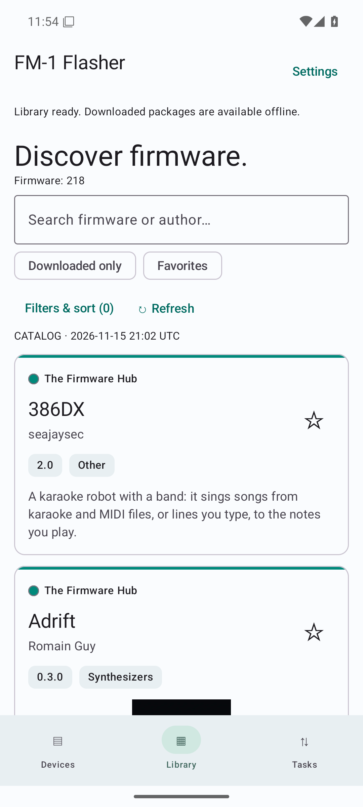
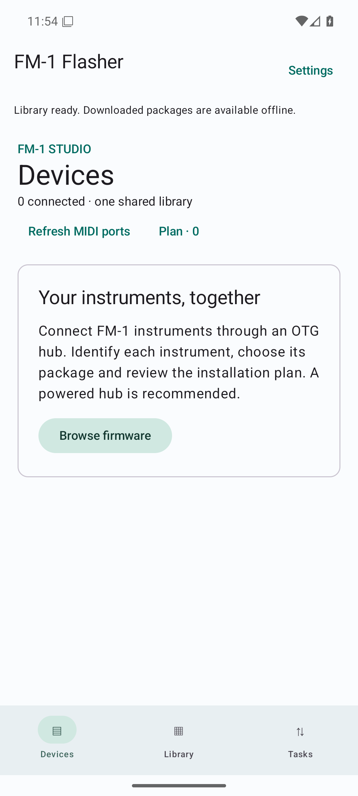
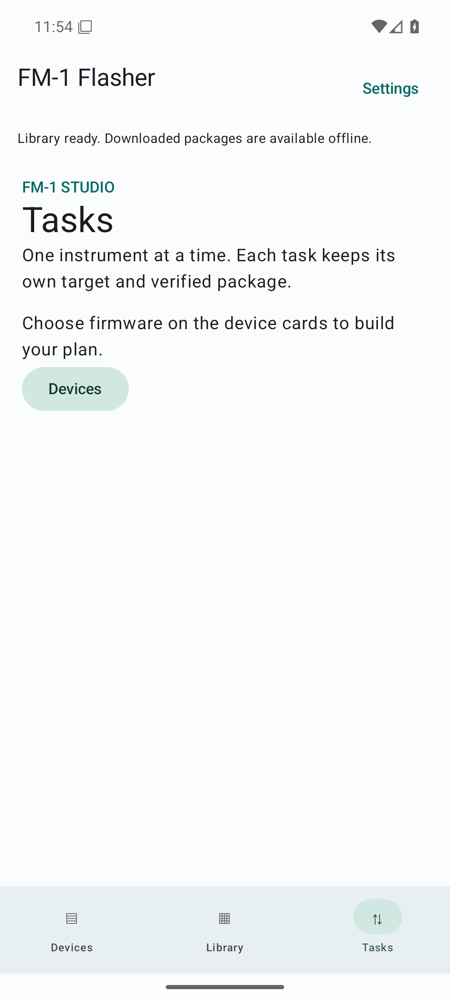
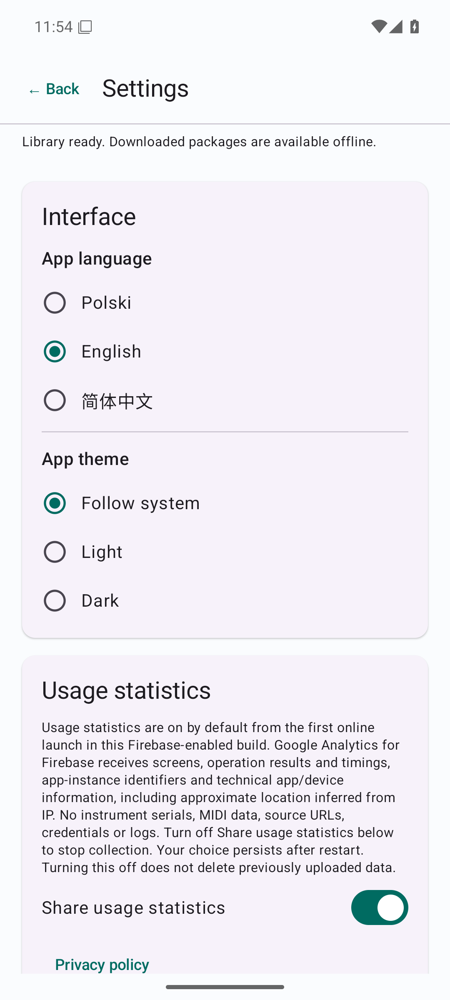
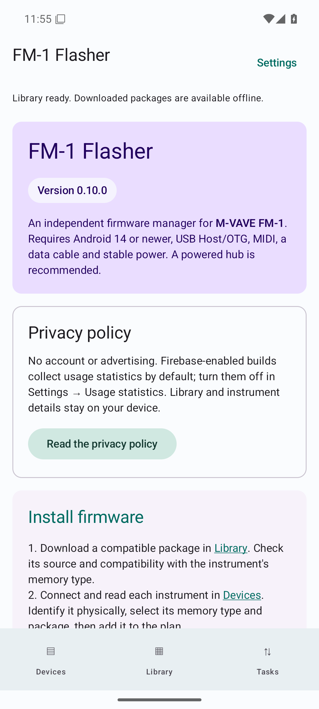
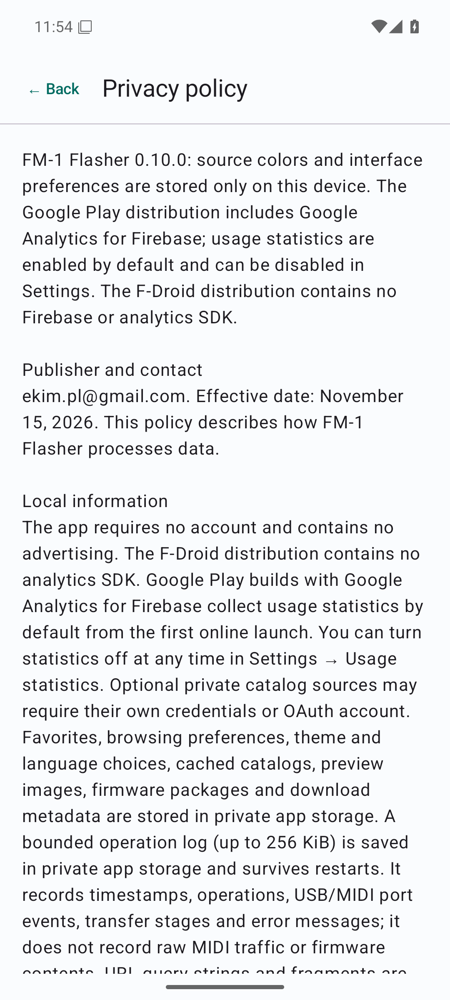
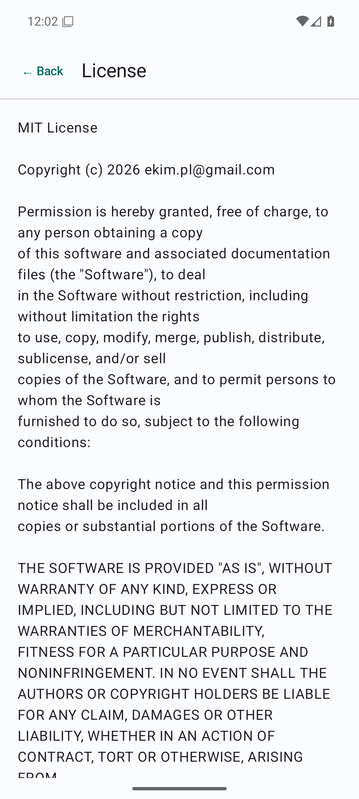
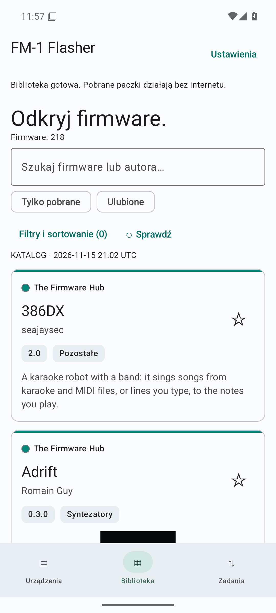
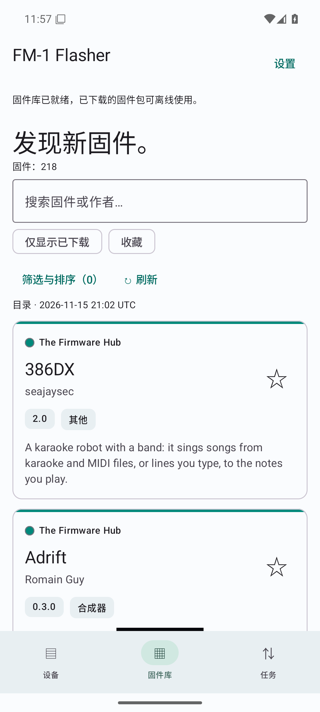

# 应用截图库

FM-1 Flasher **0.10.0 / 31**，Android 16，1080 × 2400。这些是真实 Google Play 测试版本的截图，使用测试 Firebase 项目。设备和任务页显示未连接状态，没有模拟硬件更新。固件描述保留作者原文。点击图片可打开原始 PNG。

## 英语界面

  
**固件库 — 搜索、来源颜色和固件卡片**

  
**设备 — 未连接乐器**

  
**任务 — 空的安装计划**

  
**设置 — 语言、主题和使用统计**

  
**关于 — 版本 0.10.0**

  
**隐私 — Google Play 和 F-Droid 发行版本**

  
**许可证 — 内置 MIT 原文**

## 其他界面语言

  
**波兰语固件库**

  
**简体中文固件库**
